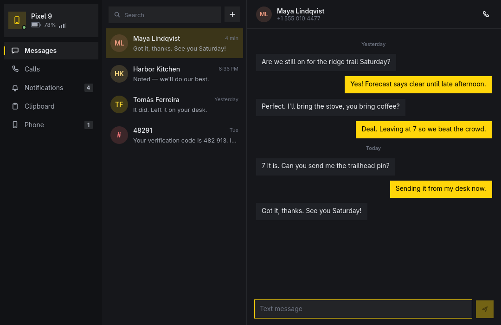

# Omalink



Your Android phone on your Omarchy desktop: read and send texts, place and
take calls, see and answer notifications, and share the clipboard. It works
over Bluetooth alone, so there are no accounts, no servers, and no need for
the phone and computer to share a network.

The desktop app is Rust with a Qt Quick (QML) interface. The phone app is a
small Kotlin shell around a Rust core. Both ends compile the same protocol
crate, so they cannot disagree about what a message means.

## What it does

| | |
|---|---|
| **Messages** | Conversations and threads from the phone, search, new messages with contact lookup, send from the keyboard. |
| **RCS chats** | Google's Messages for Web in its own tab, for RCS conversations, media, typing indicators, and read receipts. Loaded only when you open it. |
| **Calls** | Dial pad, contact search, call history, answer and decline. With hands-free connected, the call's audio uses the computer's speakers and microphone, with mute and a tone keypad. |
| **Notifications** | Every phone notification in a list and as a desktop notification, with its buttons. Dismiss on either side, reply inline where the app allows it. |
| **Clipboard** | Text copied on the computer lands on the phone's clipboard. From the phone, share text to Omalink or tap *Send clipboard* in its notification. |
| **Files** | Drop a file on the window to send it to the phone; share a file to Omalink on the phone to send it here. Files go over Wi-Fi, encrypted, straight between the two, so both need to be on the same network. |
| **Phone** | Pair, connect, and forget devices without leaving the app. See battery and signal. Ring the phone to find it. |
| **Permissions** | The desktop shows what the phone has allowed. *Ask on phone* puts the permission prompt on the phone's screen. |

## Install

Desktop, on Omarchy or any Arch system with Hyprland:

```sh
bin/install
```

That builds the package and installs it, so Omalink appears in the launcher
(`Super + Space`). Rust is taken from `mise` (`mise install` in this
directory) or from your `PATH`.

Phone, once:

```sh
bin/setup-android    # Android SDK + NDK into ~/Android/Sdk, about 2 GB
bin/build-android    # writes build/omalink.apk
~/Android/Sdk/platform-tools/adb install -r build/omalink.apk
```

Or copy `build/omalink.apk` to the phone and open it.

## First connection

1. Open **Omalink** on the phone and tap **Allow everything**. Android asks
   for each permission in turn. Two of them (notification access and running
   in the background) are switches in Settings that it opens for you.
2. On the phone, open Bluetooth settings so it can be found.
3. On the computer, open Omalink → **Phone** → **Scan**, and press **Pair**
   next to the phone. Compare the code and confirm on both.

It connects by itself from then on, whenever the phone is in range.

Android greys out notification access and SMS for apps installed outside the
Play Store. If that happens: phone Settings → Apps → Omalink → ⋮ → **Allow
restricted settings**.

To keep the link alive from login, start it without a window. In
`~/.config/hypr/autostart.lua` (or wherever you keep autostart commands):

```
omalink --background
```

Closing the window keeps it running; opening Omalink again raises the same
window. `Ctrl+Q` quits.

## Keyboard

| Key | Action |
|---|---|
| `Ctrl+1` … `Ctrl+7` | Messages, RCS chats, Calls, Notifications, Clipboard, Files, Phone |
| `Ctrl+N` | New message |
| `Ctrl+F` | Search messages |
| `Ctrl+D` | Dial a number |
| `Enter` | Send the message · call the number |
| `Shift+Enter` | New line in a message |
| `Ctrl+Enter` | Answer an incoming call |
| `Ctrl+.` | Hang up or decline |
| `Ctrl+R` | Refresh from the phone |
| `Ctrl+W` | Close the window, stay connected |
| `Ctrl+Q` | Quit |
| `?` | Show the shortcuts |

## How it works

```
 desktop (Rust + QML)                         phone (Kotlin + Rust)
 ┌──────────────────────┐   RFCOMM, framed   ┌───────────────────────┐
 │ core: one task, one  │◄──── JSON ────────►│ LinkService           │
 │ event channel        │                    │  SMS, contacts, calls │
 │  bluez   pair/connect│                    │ NotifListener         │
 │  link    data channel│   HFP (BlueZ +     │ core (Rust, JNI):     │
 │  telephony  calls    │◄── PipeWire) ─────►│  same protocol crate  │
 │  desktop clip/notify │                    └───────────────────────┘
 └──────────────────────┘
```

- **`crates/proto`** is the protocol: message types and length-prefixed
  framing, with no I/O. Both apps link it.
- **Data** travels on a Bluetooth RFCOMM channel that BlueZ opens when the
  desktop asks for Omalink's service on the phone. Only a paired device can
  connect, and Bluetooth encrypts the link.
- **Calls** use the standard hands-free profile. WirePlumber is the
  hands-free unit and carries the audio; Omalink drives it through
  `org.pipewire.Telephony`. Nothing extra to install.
- **The window** holds no state of its own. The core tells it what is true by
  topic, and it sends back what the user did.

## Limits worth knowing

- **The Messages tab is SMS only**, not MMS pictures or group MMS. RCS chats
  ("chat features" in Google Messages) are not readable by any third-party
  app, so they live in the **RCS chats** tab instead, which embeds Google's
  Messages for Web. That tab needs `qt6-webengine` and an internet
  connection, and uses a few hundred megabytes of memory while open; it is
  released ten minutes after you leave it.
- **Phone → computer clipboard is not automatic.** Android only lets an app
  read the clipboard while it is on screen. Share → Omalink and the *Send
  clipboard* button are the ways across.
- **Marking messages read** on the phone is reserved for the default SMS app.
- **Call audio** needs the phone to offer hands-free over Bluetooth, which
  nearly all do. Without it you can still dial, answer, and hang up from the
  desktop; the audio stays on the phone.
- The phone app is built for arm64 and Android 10 or newer.

## Developing

```sh
bin/build            # release binary in build/omalink
bin/test             # protocol and desktop tests, then renders the real window offscreen
build/omalink --demo # the interface with made-up data and no Bluetooth
```

`src/` layout: `desktop/src` is the Rust core (`core.rs` coordinates;
`bluez.rs`, `link.rs`, `telephony.rs`, `desktop.rs` each wrap one system
service), `desktop/qml` is the interface, `android/app` is the Kotlin shell,
and `android/core` is its Rust library.

The interface follows the Omarchy theme and Hyprland's window rounding live.
Its text is written with `qsTr()` throughout, ready for translation catalogs;
none ship yet, so it is in English.

## License

MIT.
