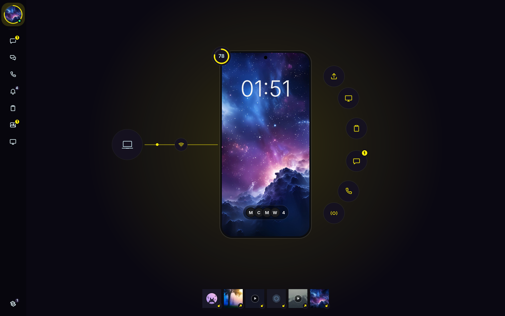
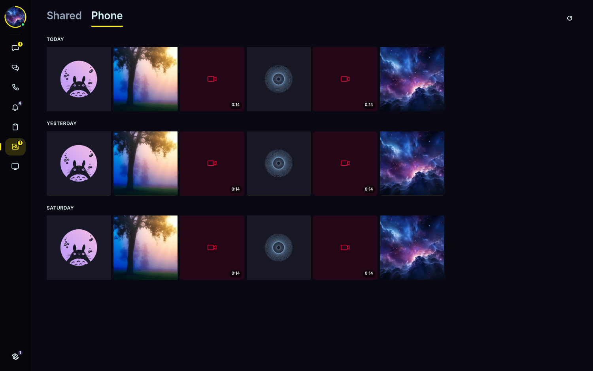
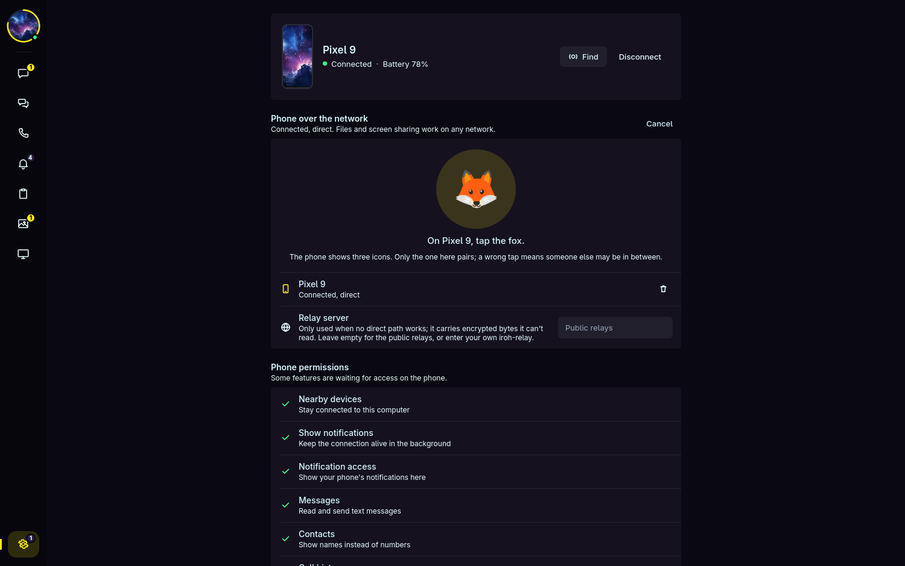
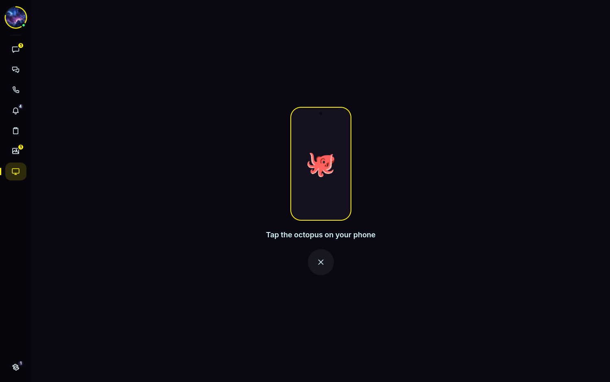

# Omalink



| | |
|---|---|
|  |  |
|  |  |

Your Android phone on your Omarchy desktop: read and send texts, place and
take calls, see and answer notifications, share the clipboard, send files,
and see and use the phone's screen. It works over Bluetooth alone, with no
accounts and no servers; pair the two over the network as well and files,
screen sharing, and everything but call audio work from anywhere.

The desktop app is Rust with a Qt Quick (QML) interface. The phone app is a
small Kotlin shell around a Rust core. Both ends compile the same protocol
crate, so they cannot disagree about what a message means.

## What it does

| | |
|---|---|
| **Messages** | Conversations and threads from the phone, search, new messages with contact lookup, send from the keyboard. |
| **RCS chats** | Google's Messages for Web in its own tab, for RCS conversations, media, typing indicators, and read receipts. Loaded only when you open it. |
| **Calls** | Dial pad, contact search, call history, answer and decline. With hands-free connected, the call's audio uses the computer's speakers and microphone, with mute and a tone keypad. |
| **Notifications** | Every phone notification in a list and as a desktop notification, with its buttons. Dismiss on either side, reply inline where the app allows it. |
| **Clipboard** | Text copied on the computer lands on the phone's clipboard. From the phone, share text to Omalink or tap *Send clipboard* in its notification. |
| **Files** | Drop a file on the window to send it to the phone; share a file to Omalink on the phone to send it here. Once paired over the network they go on any network: straight between the two when they can, through an encrypted relay when they can't. |
| **Screen** | The phone's screen in a tab, live. With control switched on, click to tap, drag to swipe, scroll with the wheel, right-click for Back, and type. Every session starts with the icon check below. |
| **Icon check** | Pairing over the network, and every screen-sharing session, shows one icon on the computer and three on the phone. Only tapping the matching one goes through. |
| **Gallery** | The phone's photos and videos by day, on the Files page. Download or delete in bulk; deleting is confirmed on the phone. |
| **Omadrop** | Share anything to Omalink on the phone: a sheet with a radar, the files flying in, a progress ring and a burst when they land. |
| **Phone** | Pair, connect, and forget devices without leaving the app. See battery and signal. Ring the phone to find it. |
| **Setup** | A guided tour on the phone: one permission at a time, including the way past Android's "restricted setting" wall. |
| **Permissions** | The desktop shows what the phone has allowed. *Ask on phone* puts the permission prompt on the phone's screen. |

## Install

Desktop, on Omarchy or any Arch system with Hyprland:

```sh
yay -S omalink
```

Phone: download `omalink.apk` from the
[latest release](https://github.com/Shrujal00/omalink/releases/latest), open
it on the phone, and allow installing it. The guided setup starts by itself.

For the bar icon, add the [Omalink bar plugin](https://github.com/Shrujal00/omalink-bar):

```sh
omarchy plugin add https://github.com/Shrujal00/omalink-bar.git --enable
```

### From source

```sh
bin/install
```

That builds the package and installs it, so Omalink appears in the launcher
(`Super + Space`). Rust is taken from `mise` (`mise install` in this
directory) or from your `PATH`.

Phone, from source:

```sh
bin/setup-android    # Android SDK + NDK into ~/Android/Sdk, about 2 GB
bin/build-android    # writes build/omalink.apk
~/Android/Sdk/platform-tools/adb install -r build/omalink.apk
```

Or copy `build/omalink.apk` to the phone and open it.

## First connection

1. Open **Omalink** on the phone and tap **Allow everything**. Android asks
   for each permission in turn. Two of them (notification access and running
   in the background) are switches in Settings that it opens for you.
2. On the phone, open Bluetooth settings so it can be found.
3. On the computer, open Omalink → **Phone** → **Scan**, and press **Pair**
   next to the phone. Compare the code and confirm on both.

It connects by itself from then on, whenever the phone is in range.

To reach the phone beyond Bluetooth, and for screen sharing, pair over the
network too:

1. On the computer, open Omalink → **Phone** → **Pair a phone**.
2. On the phone, open Omalink → **Pair with a computer** and pick it. It
   shows up by itself on the same Wi-Fi; otherwise connect over Bluetooth
   first and the computer tells the phone where to find it.
3. The computer shows an icon and the phone three. Tap the one that matches.

From then on the phone connects to the computer by itself whenever both have
internet, on any network. To let the computer use the phone during screen
sharing, turn on **Omalink control from computer** under Accessibility on the
phone (**Allow everything** offers it).

Android greys out notification access and SMS for apps installed outside the
Play Store. If that happens: phone Settings → Apps → Omalink → ⋮ → **Allow
restricted settings**.

To keep the link alive from login, start it without a window. In
`~/.config/hypr/autostart.lua` (or wherever you keep autostart commands):

```
omalink --background
```

Closing the window keeps it running; opening Omalink again raises the same
window. `Ctrl+Q` quits.

## Keyboard

| Key | Action |
|---|---|
| `Ctrl+1` … `Ctrl+9` | Home, Messages, RCS chats, Calls, Notifications, Clipboard, Files, Screen, Phone |
| `Ctrl+N` | New message |
| `Ctrl+F` | Search messages |
| `Ctrl+D` | Dial a number |
| `Enter` | Send the message · call the number |
| `Shift+Enter` | New line in a message |
| `Ctrl+Enter` | Answer an incoming call |
| `Ctrl+.` | Hang up or decline |
| `Ctrl+R` | Refresh from the phone |
| `Ctrl+W` | Close the window, stay connected |
| `Ctrl+Q` | Quit |
| `?` | Show the shortcuts |

## How it works

```
 desktop (Rust + QML)                         phone (Kotlin + Rust)
 ┌──────────────────────┐   RFCOMM, framed   ┌───────────────────────┐
 │ core: one task, one  │◄──── JSON ────────►│ LinkService           │
 │ event channel        │                    │  SMS, contacts, calls │
 │  bluez   pair/connect│                    │ NotifListener         │
 │  link    data channel│   HFP (BlueZ +     │ core (Rust, JNI):     │
 │  telephony  calls    │◄── PipeWire) ─────►│  same protocol crate  │
 │  desktop clip/notify │                    └───────────────────────┘
 └──────────────────────┘
```

- **`crates/proto`** is the protocol: message types and length-prefixed
  framing, with no I/O. Both apps link it.
- **Data** travels on a Bluetooth RFCOMM channel that BlueZ opens when the
  desktop asks for Omalink's service on the phone. Only a paired device can
  connect, and Bluetooth encrypts the link.
- **Calls** use the standard hands-free profile. WirePlumber is the
  hands-free unit and carries the audio; Omalink drives it through
  `org.pipewire.Telephony`. Nothing extra to install.
- **The network link** is QUIC through [iroh](https://iroh.computer), shared
  by both apps in `crates/net`. Each device's address is its public key, so
  it is found wherever it is: across the local network (mDNS), straight to
  the computer's public IP (it asks the router to open a port with UPnP,
  NAT-PMP or PCP), by punching through NAT, or through a relay that only sees
  encrypted bytes. The public relays are used unless you enter your own
  `iroh-relay` on the Phone page. The computer only accepts phones it paired
  with, and pairs only while you have pairing open.
- **The icon check** (`crates/proto/src/pair.rs`) ties those keys to the two
  screens in front of you. The phone commits to a random number before the
  computer picks its own, so nobody in between can search for keys that
  happen to show the same icon; a mismatch gets through one time in 64, and
  three wrong taps close pairing.
- **Screen sharing** is the phone's hardware H.264 encoder on a stream of its
  own, decoded here with OpenH264. Control is an Android accessibility
  service that does nothing outside a session that passed the icon check.
- **The window** holds no state of its own. The core tells it what is true by
  topic, and it sends back what the user did.

## Limits worth knowing

- **The Messages tab is SMS only**, not MMS pictures or group MMS. RCS chats
  ("chat features" in Google Messages) are not readable by any third-party
  app, so they live in the **RCS chats** tab instead, which embeds Google's
  Messages for Web. That tab needs `qt6-webengine` and an internet
  connection, and uses a few hundred megabytes of memory while open; it is
  released ten minutes after you leave it.
- **Phone → computer clipboard is not automatic.** Android only lets an app
  read the clipboard while it is on screen. Share → Omalink and the *Send
  clipboard* button are the ways across.
- **Marking messages read** on the phone is reserved for the default SMS app.
- **Call audio** needs the phone to offer hands-free over Bluetooth, which
  nearly all do. Without it you can still dial, answer, and hang up from the
  desktop; the audio stays on the phone.
- **Screen sharing asks twice** each session: the icon check, then Android's
  own screen-capture prompt, which Android requires every time.
- **Control** needs the accessibility switch on the phone; without it the
  screen is view only. Keys without text other than Enter, Backspace, Delete
  and the arrows aren't sent.
- **Through a relay**, which happens when neither side's network lets a
  direct path through (carrier-grade NAT on both, say), files and the screen
  are slower.
- The phone app is built for arm64 and Android 10 or newer. The network code
  makes it about 11 MB.

## Developing

```sh
bin/build            # release binary in build/omalink
bin/test             # protocol and desktop tests, then renders the real window offscreen
build/omalink --demo # the interface with made-up data and no Bluetooth
```

Without a phone, two stand-ins speak the network protocol to a running
desktop (a debug build logs the icon it shows, so they can tap it):

```sh
cargo run -p omalink-net --example fakephone -- --state /tmp/fake pair      # asks which icon
cargo run -p omalink-net --example fakephone -- --state /tmp/fake link --send FILE --video CLIP.h264
cargo run -p omalink-core --example phone_e2e -- /tmp/phone DESKTOP_LOG FILE  # the phone app's own core
```

`busctl --user call io.omalink.App /io/omalink/App io.omalink.App Pair` (or
`Mirror`) opens pairing or starts screen sharing from a script or keybinding.
`RUST_LOG=iroh=debug omalink` shows how the network link finds the phone.

`src/` layout: `desktop/src` is the Rust core (`core.rs` coordinates;
`bluez.rs`, `link.rs`, `telephony.rs`, `desktop.rs` each wrap one system
service, `net.rs` the network link and `video.rs` the mirrored screen),
`desktop/qml` is the interface, `crates/net` is the network link both apps
share, `android/app` is the Kotlin shell, and `android/core` is its Rust
library, including the phone's side of the network link (`net.rs`).

The interface follows the Omarchy theme and Hyprland's window rounding live.
Its text is written with `qsTr()` throughout, ready for translation catalogs;
none ship yet, so it is in English.

## License

MIT.
